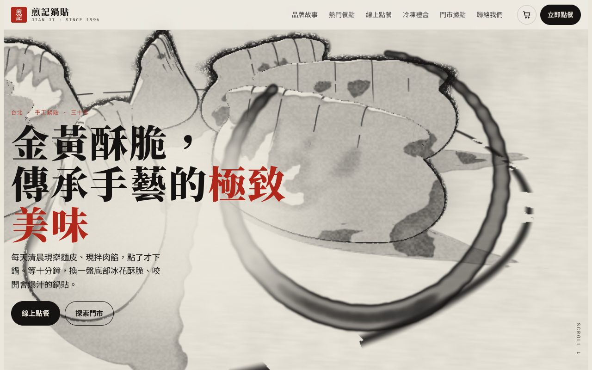
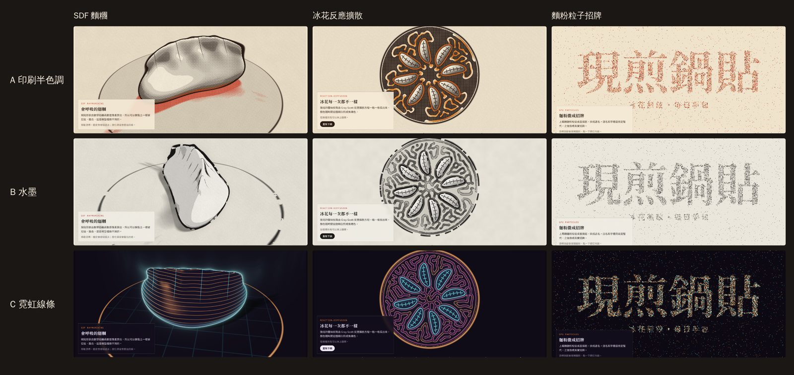
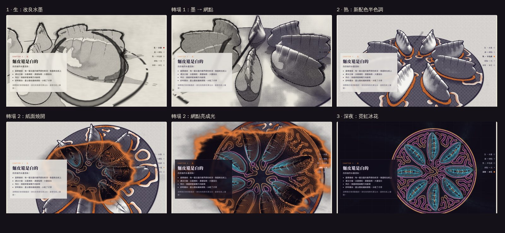
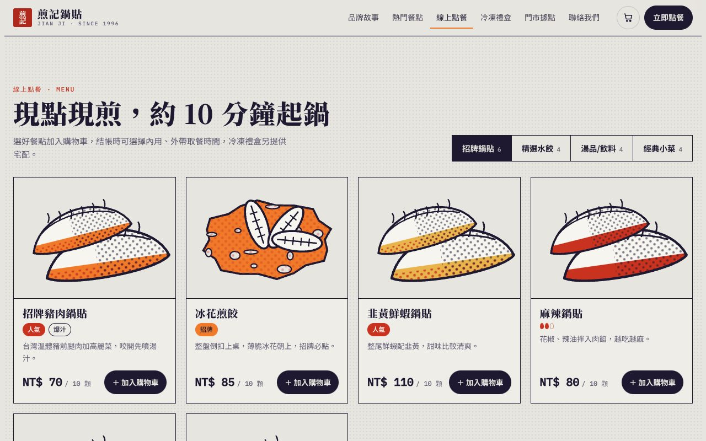
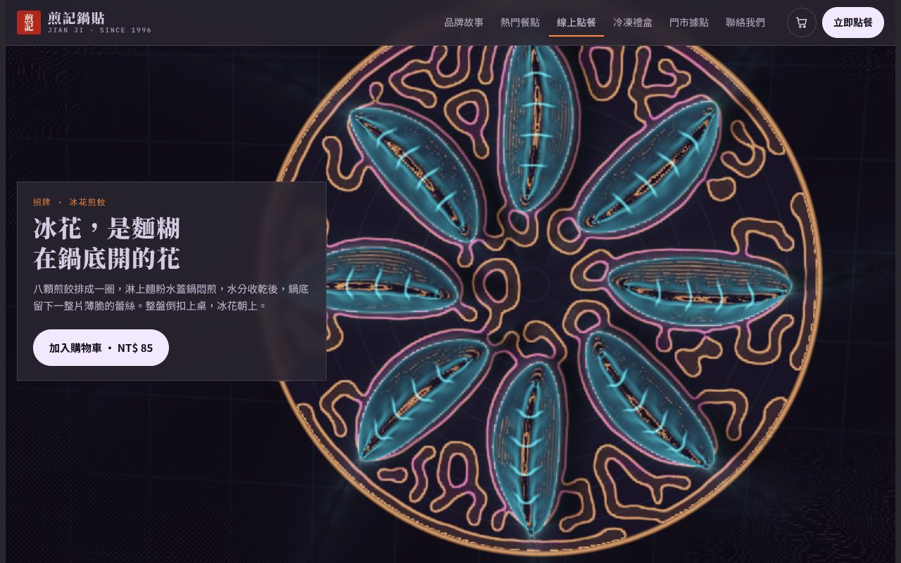
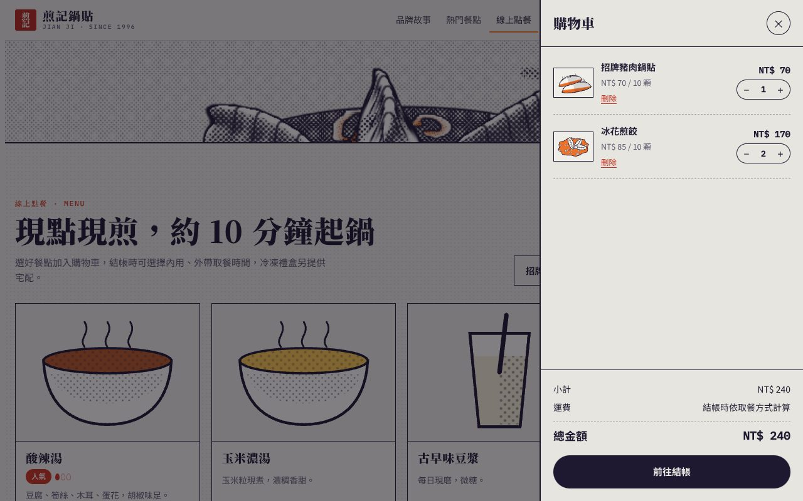
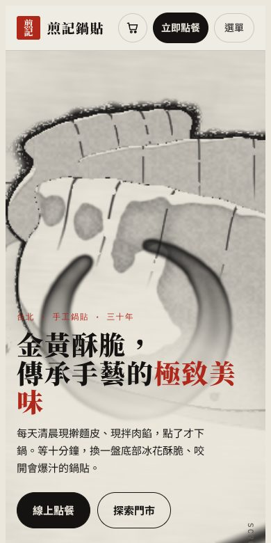

# 煎記鍋貼 · 3D 捲動敘事餐廳網站

一個虛構鍋貼店的官網原型。整個網站是一段可以捲動的即時 3D 動畫：一鍋鍋貼**從生到熟、從白天到深夜**，畫風依序從**水墨**變成**印刷半色調**，再變成**霓虹**。點餐、禮盒、門市等店家資訊則穿插在章節之間，盡量不打斷動畫的節奏。

**線上展示：** https://bshen2452-alt.github.io/potsticker-3d-site/



> 「煎記鍋貼」是虛構品牌。門市地址、電話、價格、LINE 帳號等全部是示範資料，路名也是虛構的；結帳和電子報表單不會送出任何資料。

---

## 設計概念

一般店家網站是首頁、菜單、地址，再加幾張會動的圖。這個專案把整個網站做成**同一個連續的 3D 場景**：鏡頭從一顆生鍋貼的側面特寫開始，捲動時拉遠看到整鍋，最後變成正上方俯視。

三種畫風是同一份 3D 資料的三種上色方式，所以轉場可以停在任何一格，往回捲也會倒轉。

| 章節 | 畫風 | 鏡頭 | 意義 |
|---|---|---|---|
| 生 | 水墨 | 單顆鍋貼側面特寫 | 生麵皮是白的，強調手工 |
| 轉場 | 墨暈收斂成網點 | 拉遠 | 水墨「被印刷出來」 |
| 熟 | 印刷半色調 | 整鍋斜角 | 熱度讓顏色出現，冰花開始生長 |
| 轉場 | 紙面燒開，網點亮成光 | 升高 | 從煎鍋的火延伸到夜晚 |
| 深夜 | 霓虹線條 | 正上方俯視 | 冰花起鍋，整站高潮 |





### 只有即時渲染才做得到的部分

- **SDF Raymarching**：鍋貼由距離函數逐像素算出，沒有模型檔。游標靠近時麵皮會被輕輕吸過去。
- **反應擴散（Gray-Scott）**：冰花脆底的蕾絲紋路一格一格即時長出來，每次重新整理都不一樣。
- **水墨模擬**：墨暈邊緣、濃淡分層、順著筆觸方向的飛白，開場的圓相會沿著紙纖維暈開。
- **轉場在 shader 裡完成**：墨暈收斂成網點陣列、紙面燒穿、網點變成光點，全部隨捲動即時運算。

---

## 店家資訊怎麼放

輕的資訊浮在動畫上；重的資訊用一整張「紙」蓋上來，蓋住時 3D 會暫停運算。

| 順序 | 位置 | 內容 |
|---|---|---|
| 1 | 水墨章節 | 主視覺 Slogan 與「線上點餐」「探索門市」按鈕 |
| 2 | 水墨章節 | 品牌故事、三個食材堅持 |
| 3 | 轉場 1 | 數據：每日 10,000+ 顆、100% 現點現煎、30 年 |
| 4 | 半色調章節 | 熱門餐點三樣，可直接加入購物車 |
| 5 | 印刷菜單紙（3D 暫停） | 線上點餐：四個分類、商品卡片 |
| 6 | 霓虹章節 | 招牌冰花煎餃 |
| 7 | 深夜底色區塊 | 冷凍禮盒、門市據點、FAQ、頁尾 |

<p>


</p>
<p>


</p>

## 功能

- 頂部導覽：平滑捲動到各段、目前段落標示、手機版選單、購物車數量、立即點餐
- 購物車：加入時顯示提示；側邊抽屜可加減數量、刪除、計算小計與總金額
- 結帳：內用、外帶、宅配，依方式顯示門市、取餐時段、人數或地址；欄位檢查；送出後顯示訂單編號並清空購物車
- 宅配規則：只開放冷凍禮盒，滿 NT$ 1,500 免運
- 門市：依台北時間即時判斷營業中、已打烊或公休（含跨午夜營業）；霓虹風格地圖可縮放，附 Google 地圖連結
- 常見問題：手風琴效果，一次展開一題
- 電子報訂閱表單（只檢查格式，不會送出）
- 支援 `prefers-reduced-motion`，手機寬度可用



---

## 執行

不需要安裝任何套件。直接用瀏覽器開啟 `index.html`，或啟動任何靜態伺服器：

```bash
python3 -m http.server 8000
```

然後打開 http://localhost:8000 。

需要支援 WebGL 2 的瀏覽器。3D 場景是單一全螢幕 raymarching，桌機獨立或內建顯示卡都能順跑；手機效能尚未最佳化。

## 修改與建置

原始碼分成四個部分，修改後執行 `build.py` 會重新產生 `index.html`：

```bash
python3 build.py
```

```
src/
  a_page.html        版面、CSS、所有區塊的 HTML
  b_engine.js        3D 引擎：shader（水墨、半色調、霓虹、兩個轉場）、反應擴散、水墨模擬、鏡頭路徑
  c_engine_tail.js   捲動對應章節進度、資訊頁覆蓋時暫停、開場圓相、主迴圈
  d_shop.js          菜單與商品資料、購物車、結帳、門市、FAQ、電子報
prototypes/
  01-art-directions.html   三種美術方向比較原型
  02-transitions.html      三個轉場原型
  src/                     原型原始檔
docs/images/               README 截圖
build.py                   組合成 index.html
```

菜單、禮盒、門市、FAQ 的內容都集中在 `src/d_shop.js` 開頭的 `ITEMS`、`GIFTS`、`STORES`、`FAQ` 陣列，換成真實資料即可。

## 使用的資源

- [three.js](https://threejs.org/) r128（MIT License），由 cdnjs 載入
- [Noto Serif TC、Noto Sans TC](https://fonts.google.com/)、[IBM Plex Mono](https://fonts.google.com/specimen/IBM+Plex+Mono)（SIL Open Font License），由 Google Fonts 載入
- 商品插圖、地圖、圖示皆為程式產生的 SVG

Uber Eats、foodpanda、Google 地圖為各自公司的商標。本專案只以文字提及，與這些公司沒有任何合作或關聯。

## 授權

[MIT License](LICENSE)
